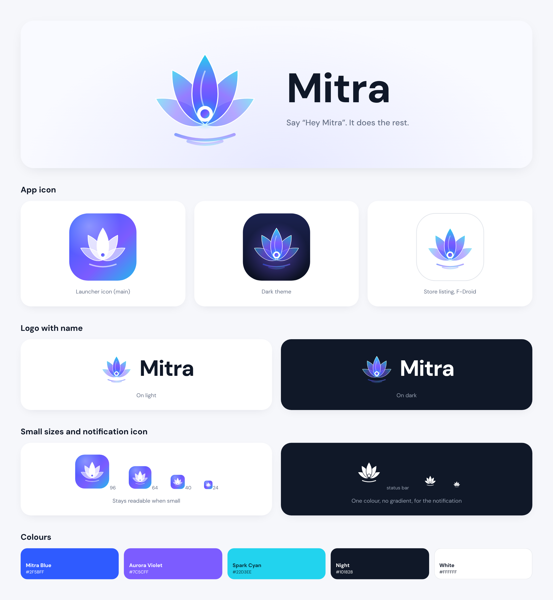

# Mitra brand

The mark is a **lotus with a glowing core** over two ripple arcs. "Mitra" means *friend*; the lotus is friendly and Indian; the core is the same orb the user taps and speaks to, and the arcs read as water and as a sound wave.

## Which file to use

| Need | File |
|---|---|
| Logo on a website, slide, README, poster | `png/mark/transparent/lotus-color.png` or `svg/lotus-color.svg` |
| Logo with the name | `png/lockup/transparent/horizontal-for-light.png` (dark text) / `horizontal-for-dark.png` (white text); stacked versions too |
| Launcher icon (already installed in `app/src/main/res`) | `png/app-icon/square/icon-gradient.png`; Play-style 512 px: `png/android/play-store-icon-512.png` |
| Dark theme icon / store listing | `icon-night.png` / `icon-white.png` in `png/app-icon/square/` (round versions in `round/`) |
| One colour only (notification, print, stamps) | `png/mark/transparent/lotus-white.png`, `lotus-night.png`, `lotus-blue.png`; notification icons in `png/android/notification/` |
| Favicons, social image | `png/web/` (16–512 px favicons, 1200×630 banner) |
| Android adaptive icon layers | `png/android/adaptive/` (foreground, background, monochrome) |
| Source vectors | `svg/` |

Folders named `transparent/` have no background; `with-background/` has the same artwork on light, night, white or the gradient.

## Colours

| Name | Hex | Use |
|---|---|---|
| Mitra Blue | `#2F5BFF` | primary buttons, links |
| Aurora Violet | `#7C5CFF` | gradient, orb |
| Spark Cyan | `#22D3EE` | gradient, orb |
| Night | `#101828` | text, dark surfaces |

Full UI tokens (status colours, neutrals): `docs/UI_SPEC.md` §2 and `modules/ui/.../Theme.kt`.

## Font

Name: **DM Sans Bold**, tight tracking (−2.5%). DM Sans is open source (SIL Open Font License), so it can be bundled in the app and used in the name lockup.

## Rules

- Leave clear space around the mark of at least half the width of the centre petal.
- Smallest size: 24 px for the coloured mark, 16 px for the icon tile; below that use the flat one-colour version.
- Keep the mark upright. Don't stretch, rotate, recolour, add outlines or effects, or put the coloured mark on a busy photo.
- On a dark background use the dark-theme versions or the white mark; on light use the coloured mark.
- Do not redraw the logo. If a new size or format is needed, regenerate it from `svg/` or ask the owner.

## In code

- Launcher and notification icons: `app/src/main/res/` (`mipmap-*`, `drawable-*/ic_stat_mitra.png`, adaptive icon XML with a monochrome layer for Android 13+ themed icons).
- In-app logo: `modules/ui/src/main/res/drawable-nodpi/mitra_lotus.png` (512 px). The animated orb is drawn in Compose (`MitraOrb`), not an image.
